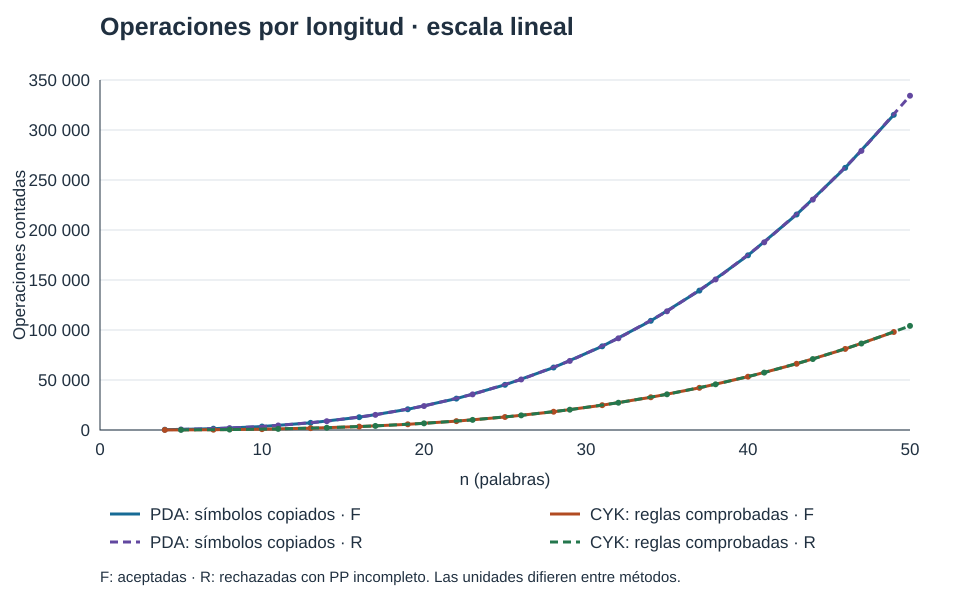
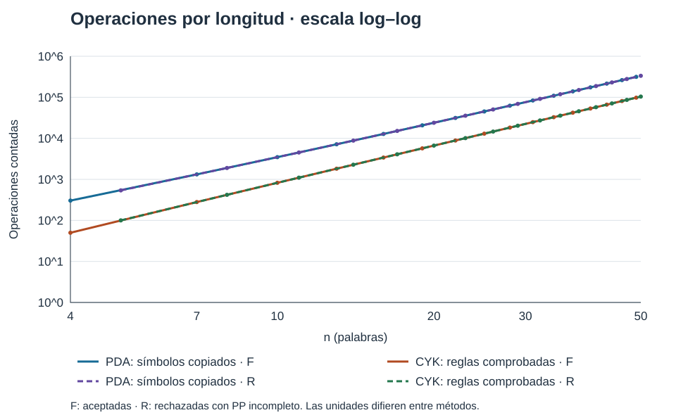

<section class="title-page">
<h1>Proyecto 2: Reconocimiento con PDA y CYK</h1>
<p class="authors">David López — carné 24730<br>
Carlos López — carné 24531</p>
<p>Departamento de Ciencias de la Computación,<br>Universidad del Valle de Guatemala</p>
<p>CC2019 Teoría de la Computación, sección 30</p>
<p>Tomás Gálvez P.</p>
<p>1 de noviembre de 2026</p>
</section>

<section class="abstract" markdown="1">

## Resumen

El presente trabajo examina el reconocimiento de frases de una gramática libre de contexto mediante
dos métodos independientes: la simulación de un autómata de pila y el algoritmo CYK. La gramática,
proporcionada en Forma Normal de Chomsky, contiene ocho variables, veintiún terminales y treinta
alternativas. Se formaliza un autómata de tres estados equivalente a la gramática y se describe
su implementación como extensión del autómata finito del proyecto anterior. La simulación emplea
búsqueda en anchura, configuraciones completas y una poda segura por longitud. CYK construye una
tabla de segmentos y conserva testigos para reconstruir una derivación. La evaluación utiliza
conteos de operaciones, sin mediciones de tiempo, sobre cuarenta entradas aceptadas y rechazadas.
Para la gramática fija, CYK presenta crecimiento ajustado cúbico; en el autómata se obtienen
cotas superiores cuadráticas para las transiciones y cúbicas para los símbolos copiados. Los
resultados distinguen las unidades de operación y muestran la sensibilidad del autómata a los
rechazos tempranos, frente al recorrido completo de la tabla CYK. La validación comprende
cincuenta y siete pruebas y comparación cruzada sobre cadenas cortas. Se concluye que la
estructura de la gramática, la representación de las pilas y la conservación de evidencia
condicionan la comparación entre ambos métodos.

<p class="keywords"><em>Palabras clave:</em> autómata de pila, CYK, gramática libre de contexto,
conteo de operaciones, complejidad asintótica</p>

</section>

[TOC]

<h1 class="body-title">Proyecto 2: Reconocimiento con PDA y CYK</h1>

Reconocer frases del lenguaje de la gramática G del enunciado con dos métodos independientes:
un autómata de pila (PDA) obtenido de G, que extiende el autómata del proyecto 1, y el algoritmo
CYK. Ambos registran los pasos que justifican su respuesta. Además se calcula la tasa de
crecimiento de cada programa mediante conteo de operaciones y se comparan sus desempeños.


La gramática y los requisitos corresponden al enunciado de la Universidad del Valle de Guatemala
(2026). El código y los materiales reproducibles se encuentran en el
[repositorio del proyecto](https://github.com/DeividArriaza/proyecto2-tdc); la demostración está
disponible en el [video del proyecto](https://youtu.be/9PlEOdXy-zE).
La documentación técnica complementaria detalla los contratos, algoritmos y datos
(López y López, 2026). Las instrucciones de instalación y ejecución se incluyen en el Apéndice A.

## Gramática G

G = (V_G, Σ, S, R), con V_G = {S, VP, PP, NP, V, P, N, Det} y Σ = {cooks, drinks, eats, cuts, he, she,
in, with, a, the, cat, dog, beer, cake, juice, meat, soup, fork, knife, oven, spoon}.

```text
S  → NP VP              PP  → P NP              V   → cooks | drinks | eats | cuts
VP → VP PP | V NP       NP  → Det N | he | she  P   → in | with
VP → cooks | drinks | eats | cuts               Det → a | the
N  → cat | dog | beer | cake | juice | meat | soup | fork | knife | oven | spoon
```

8 variables, 21 terminales y 30 alternativas (5 binarias, 25 léxicas). G ya está en CNF.
Está definida una sola vez en `recognizer/grammar.py` y la usan ambos reconocedores; las pruebas
comparan esa definición con el enunciado. **Entrada:** cada palabra separada por espacios en blanco
es un token y n es la cantidad de palabras. No se cambian mayúsculas ni puntuación: `He cooks` y
`he cooks.` se rechazan. La cadena vacía se rechaza porque G no deriva ε.

## PDA a partir de G

### Extensión del autómata del proyecto 1

El modelo AFN del proyecto 1 se reutiliza con imports relativos y comentarios de procedencia en `recognizer/proyecto1/` (commit `750243e`
de `primer-proyecto-tdc`). `AutomataPila` en `recognizer/automata.py` **hereda** de esa clase y
agrega alfabeto de pila Γ, símbolo de fondo Z0 y transiciones `(estado, lectura|ε, cima) →
{(destino, secuencia_a_apilar)}`. La pila es una tupla con la cima en el índice 0; reemplazar la cima
por `()` desapila. EPSILON se toma del proyecto 1.

### Definición formal

M = (Q, Σ, Γ, δ, q0, Z0, F) con Q = {q0, q1, q2}, Γ = V_G ∪ Σ ∪ {Z0}, F = {q2} y:

1. δ(q0, ε, Z0) = {(q1, S Z0)} — inicialización.
2. Para cada A → α en R: (q1, α) ∈ δ(q1, ε, A) — expansión de variables.
3. Para cada a ∈ Σ: δ(q1, a, a) = {(q1, ε)} — coincidencia de terminales.
4. δ(q1, ε, Z0) = {(q2, Z0)} — finalización.

Acepta por estado final con toda la entrada consumida. Invariante: en q1, si se leyó el prefijo u y
la pila contiene β Z0, entonces S ⇒\* uβ por una derivación izquierda; al aceptar, β = ε y S ⇒\* w. Por tanto L(M) ⊆ L(G). Recíprocamente, cada
derivación izquierda de una palabra de G se simula mediante las expansiones de su variable
izquierda y la lectura de los terminales resultantes, hasta quedar Z0 y habilitar q2.
Así L(G) ⊆ L(M) y L(M) = L(G). Esta construcción corresponde a la equivalencia entre gramáticas libres de contexto y
autómatas de pila descrita por Hopcroft et al. (2007) y Sipser (2013). Las notas de
Stony Brook University (s. f.) presentan la misma estrategia de derivación izquierda.

Formalmente δ: Q × (Σ ∪ {ε}) × Γ → ℘(Q × Γ*); los casos no enumerados tienen
conjunto de destinos vacío. La pila inicial es Z0 y su cima se escribe a la izquierda.
En q2 queda el fondo: se acepta por estado final, no por vaciar la pila.

### Simulación y evidencia

El algoritmo mantiene una cola con la configuración inicial (q0, 0, (Z0,)). Antes de expandir
el frente comprueba aceptación y después el límite opcional. Para cada configuración extraída
consulta las transiciones ε y, si queda entrada, las del siguiente token. Cada destino crea
`apilar + pila[1:]`; la posición avanza solo con lectura. Primero aplica la poda, después
descarta visitadas y finalmente guarda el padre, la transición y el sucesor en la cola.
Si la cola se vacía devuelve rechazo. El límite cuenta expansiones y produce **inconclusa**.
La poda se activa automáticamente solo en autómatas certificados por la construcción sin
producciones vacías; en un PDA externo no se presume válida y no se garantiza terminación.

`recognizer/pda.py` ejecuta cualquier `AutomataPila` con búsqueda en anchura (BFS) sobre
configuraciones (estado, posición, pila completa) y un conjunto de visitadas. Como G no tiene reglas
vacías, cada símbolo sobre el fondo debe consumir al menos una palabra; una configuración con más
símbolos pendientes que palabras restantes se poda con seguridad. Esto garantiza terminación a pesar
de la recursión izquierda VP → VP PP. La evidencia contiene todas las configuraciones exploradas
con su padre y transición, el recorrido aceptante validado o la causa del agotamiento.

Como se presenta en la Tabla 1, se conserva la evidencia del reconocimiento y del conteo correspondiente.

<div class="table-block trace" markdown="1">

**Tabla 1**

*Recorrido aceptante del PDA para he cooks*

| Paso | Descripción instantánea | Acción |
| --- | --- | --- |
| 0 | (q0, he cooks, Z0) | Inicio |
| 1 | (q1, he cooks, S Z0) | Inicializar |
| 2 | (q1, he cooks, NP VP Z0) | S → NP VP |
| 3 | (q1, he cooks, he VP Z0) | NP → he |
| 4 | (q1, cooks, VP Z0) | Leer he |
| 5 | (q1, cooks, cooks Z0) | VP → cooks |
| 6 | (q1, ε, Z0) | Leer cooks |
| 7 | (q2, ε, Z0) | Finalizar |

*Nota.* La cima de la pila se escribe a la izquierda; Z0 es el símbolo de fondo.

</div>

Cada fila se relaciona con la siguiente por ⊢. Esta es la ruta aceptante reconstruida, no toda
la exploración BFS: `he cooks` genera 15 configuraciones, expande 11, evalúa 14 transiciones,
realiza 21 consultas, copia 50 símbolos y poda 3 candidatas; no encuentra repetidas.

## Algoritmo CYK

El reconocimiento ascendente mediante programación dinámica se fundamenta en el análisis
de lenguajes libres de contexto (Younger, 1967; Sipser, 2013). El recurso introductorio
enlazado en el enunciado también describe CYK (Colaboradores de Wikipedia, s. f.).

T[i, l] es el conjunto de variables que derivan las l palabras desde la posición i. La base usa las
reglas léxicas; para l = 2..n, cada corte c combina T[i, c] y T[i+c, l−c] con las reglas A → B C.
Se acepta si S ∈ T[0, n]. Cada variable guarda su primer testigo (producción, corte), con lo cual se
reconstruye un árbol y la derivación izquierda. Ejemplo `she drinks a beer`:

```text
l=4 | S
l=3 | ∅       VP
l=2 | S       ∅       NP
l=1 | NP      V,VP    Det     N
      she     drinks  a       beer
```

S ⇒ NP VP ⇒ she VP ⇒ she V NP ⇒ she drinks NP ⇒ she drinks Det N ⇒ she drinks a N ⇒ she drinks a beer.
En un rechazo (`he eats cake`) la tabla completa muestra que S no está en la celda final.

## Tasas de crecimiento

### CYK: desglose y cota ajustada

Con R_bin = 5 y R_lex = 25 reglas, los bucles recorren todas las celdas, cortes y reglas sin salidas
tempranas:

Como se presenta en la Tabla 2, se conserva la evidencia del reconocimiento y del conteo correspondiente.

<div class="table-block" markdown="1">

**Tabla 2**

*Conteos exactos del llenado de la tabla CYK*

| Operación | Conteo exacto |
| --- | --- |
| Celdas | n(n+1)/2 |
| Consultas léxicas | 25n |
| Cortes | Σ_{l=2..n} (n−l+1)(l−1) = (n³ − n)/6 |
| Comprobaciones de reglas binarias | 5(n³ − n)/6 |

*Nota.* Los valores corresponden a G, con 5 reglas binarias y 25 léxicas.

</div>

Con j = l−1, el conteo de cortes se obtiene de:

<p class="formula">∑<sub>j=0</sub><sup>n−1</sup> (n−j)j =
n · n(n−1)/2 − (n−1)n(2n−1)/6 = (n³−n)/6.</p>

La suma seleccionada C(n) = 5(n³−n)/6 + 25n + n(n+1)/2 pertenece a **Θ(n³)**.
No es el total de instrucciones ni la suma de todos los contadores: excluye, entre otras,
las altas de variables y la reconstrucción. Los tres bucles de longitud, inicio y corte,
más el recorrido completo de reglas binarias, justifican una cota ajustada para G.
Las consultas a diccionarios se consideran O(1) esperado. El `and` de Python puede omitir
la segunda consulta cuando falla la primera; las comprobaciones contadas sí son exactas.

Para gramática variable, el llenado cuesta
Θ(n² + n·|R_lex| + n³·|R_bin|), con n ≥ 2. La forma convencional
**O(n³·|G|)** es una cota superior; es **Θ(n³·|G|)** cuando |R_bin| = Θ(|G|),
como en G fija. No es una igualdad ajustada uniforme para una gramática dominada por reglas
léxicas. La validación y ordenación inicial de reglas añade O(|G| log |G|) como cota superior.
Para G esos costos son constantes.

La tabla ocupa Θ(n²) celdas con hasta 8 variables y testigos cada una. El árbol ocupa Θ(n);
la lista explícita de formas de la derivación y su reconstrucción requieren O(n²).
Esto sigue dominado por Θ(n³) en entradas largas de G. Para n = 0 todos los contadores
son cero y se rechaza sin tabla.

### PDA: cota exponencial en general, polinomial en G

La operación dominante seleccionada corresponde a símbolos de pila copiados al construir cada sucesor.
Para una CFG fija sin ε con poda, el número de configuraciones está acotado por O(n·g<sup>n+1</sup>), con
g = |Γ|, de donde se obtiene una cota superior exponencial O(n²·g<sup>n+1</sup>). Para **G** toda pila
alcanzable tiene la forma β PP<sup>k</sup> Z0, con β en un conjunto finito y 0 ≤ k ≤ n; hay O(n) pilas y
O(n²) configuraciones. Cotas superiores para G: **O(n²) transiciones evaluadas** y **O(n³) símbolos
copiados** (y memoria O(n³), porque se guardan las pilas completas como evidencia).
Las cotas anteriores son **superiores**, no tasas Θ demostradas. Suponen gramática fija,
ramificación constante y consultas hash amortizadas. En general,
C ≤ |Q|(n+1)∑<sub>h=0</sub><sup>n+1</sup>g<sup>h</sup> configuraciones;
cada una genera O(1) sucesores y cada pila cuesta O(n) al copiarse. Para G, la forma
β PP<sup>k</sup> Z0 reduce a O(n) las pilas posibles. β pertenece a un conjunto finito:
VP, V NP, verbo NP, verbo, NP, Det N, determinante N, N, sustantivo, P NP,
preposición NP, pronombre o ε; las etapas del sujeto también forman un conjunto constante.
Multiplicar por las O(n) posiciones da O(n²) configuraciones y por O(n) de copia da O(n³).

En CNF, n reglas léxicas y n−1 binarias producen 2n−1 expansiones; al sumar n lecturas
y dos pasos administrativos, cualquier ruta aceptante tiene **3n+1 transiciones**.
Esto no hace lineal a `validar_recorrido`: compara las pilas explícitas antes y después,
por lo que su costo es O(suma de longitudes de pila), a lo sumo O(n²), además de recibir
el recorrido. Buscar la ruta con BFS tiene los costos superiores ya derivados.

Como se presenta en la Tabla 3, se conserva la evidencia del reconocimiento y del conteo correspondiente.

<div class="table-block" markdown="1">

**Tabla 3**

*Definición de los contadores de la simulación PDA*

| Contador PDA | Qué mide |
| --- | --- |
| `configuraciones_generadas` | Inicial más cada candidata, aun podada o repetida |
| `configuraciones_expandidas` | Configuraciones retiradas para buscar sucesores |
| `consultas_transiciones` | Búsquedas en δ, para ε y siguiente token disponible |
| `transiciones_evaluadas` | Destinos examinados de esas consultas |
| `simbolos_copiados_pila` | 1 inicial + suma de (longitud anterior−1 + longitud nueva) |
| `podas`, `repetidas` | Candidatas descartadas por longitud o ya visitadas |

*Nota.* Los contadores corresponden a la implementación de recognizer/pda.py.

</div>

Las copias cuentan referencias de la cola de la tupla y su concatenación. No incluyen todas
las copias del registro ni el costo exacto de hash: miden el crecimiento de la representación.
Se cumple generadas = 1 + transiciones evaluadas. CYK cuenta además `reglas_satisfechas`
(coincidencias léxicas/binarias) y `variables_agregadas` (primer testigo en cada celda).

## Experimentos reproducibles

`scripts/benchmark.py` ejecuta ambos métodos sin límite de búsqueda y escribe `docs/operaciones.csv`
(40 filas, determinista; no mide tiempos). Familias, con F_k = `she eats the cake` + k veces
` with a fork` (n = 3k + 4):

Como se presenta en la Tabla 4, se conserva la evidencia del reconocimiento y del conteo correspondiente.

<div class="table-block" markdown="1">

**Tabla 4**

*Familias de entradas de los experimentos*

| Familia | Frase | k | Decisión |
| --- | --- | --- | --- |
| F | F_k | 0..15 | aceptada |
| R | F_k + ` with` (PP incompleto) | 0..15 | rechazada |
| E | `cooks ` + F_k (orden inválido desde el inicio) | 0, 5, 10, 15 | rechazada |
| D | F_k + ` dances` (palabra fuera de Σ) | 0, 5, 10, 15 | rechazada |

*Nota.* F_k es la frase base con k complementos; los datos proceden de docs/operaciones.csv.

</div>

Columnas: `pda_*` son los contadores de `docs/pda.md`; `cyk_*` los de `docs/cyk.md`;
`pda_causa` indica `frontera_agotada` o `fuera_del_alfabeto`; `pda_limite` vacío significa que no
hubo límite y, por tanto, ningún resultado es inconcluso. `coinciden` es `True` en las 40 filas.

Como se presenta en la Tabla 5, se conserva la evidencia del reconocimiento y del conteo correspondiente.

<div class="table-block" markdown="1">

**Tabla 5**

*Resumen de operaciones registradas por ambos reconocedores*

| n | PDA transiciones | PDA copias de pila | CYK comprobaciones | CYK variables agregadas |
| --- | --- | --- | --- | --- |
| 4 (F_0) | 66 | 304 | 50 | 9 |
| 7 (F_1) | 196 | 1 323 | 280 | 16 |
| 19 (F_5) | 1 376 | 20 729 | 5 700 | 44 |
| 34 (F_10) | 4 336 | 109 179 | 32 725 | 79 |
| 49 (F_15) | 8 946 | 315 154 | 98 000 | 114 |
| 50 (R_15) | 9 310 | 334 274 | 104 125 | 115 |
| 50 (E_15) | 7 | 37 | 104 125 | 117 |
| 50 (D_15) | 0 | 0 | 104 125 | 114 |

*Nota.* Datos de docs/operaciones.csv. Las unidades de los dos programas no son equivalentes.

</div>

En las 16 filas de F, los conteos coinciden exactamente con estos polinomios (y análogos en R):

- PDA, transiciones evaluadas: (11/3)n² + 3n − 14/3.
- PDA, símbolos copiados: (22/9)n³ + (71/6)n² − (107/6)n + 266/9.
- CYK, comprobaciones binarias: (5/6)(n³ − n), igual que la fórmula analítica.

## Gráficas del conteo dominante

La Figura 1 presenta el crecimiento de los conteos de ambas familias.

<figure markdown="1">

**Figura 1**

*Operaciones por longitud en escala lineal*



*Nota.* Conteos del CSV para F (aceptadas) y R (rechazadas). Se usan las copias de símbolos del PDA y las comprobaciones binarias de CYK. Las operaciones de distintos programas no cuestan lo mismo; la altura de las curvas no equivale a una comparación de segundos. Fuente: docs/operaciones.csv.

</figure>

La Figura 2 presenta el crecimiento de los conteos de ambas familias.

<figure markdown="1">

**Figura 2**

*Operaciones por longitud en escala logarítmica*



*Nota.* Los mismos datos con ambos ejes logarítmicos, incluidos los casos cortos. Las pendientes se aproximan a 3 en entradas largas de estas familias, coherentes con términos cúbicos; la evidencia finita no demuestra una cota ajustada del PDA. Fuente: docs/operaciones.csv.

</figure>

## Discusión de desempeños

**Resultados analíticos.** CYK es Θ(n³) para cualquier gramática CNF fija y cualquier entrada:
su costo es el de llenar la tabla, no el de la frase. El PDA no determinista simulado por búsqueda
no tiene, en general, una cota polinomial: para una CFG arbitraria la cota superior es exponencial,
y sin visitados ni poda la recursión izquierda podría impedir su terminación. En G, la forma restringida de
las pilas reduce el espacio de configuraciones a O(n²); por eso el PDA resulta polinomial aquí.
Esa es una propiedad de G, no del método.

**Resultados experimentales.** Medido en «decisiones» (transiciones del PDA frente a comprobaciones
de reglas de CYK), el PDA crece como n² y CYK como n³: el PDA registra más operaciones con n = 4
(66 frente a 50) y menos desde n = 7 (196 frente a 280); con n = 49, 8 946 frente a 98 000.
Medido en el trabajo real de la representación del PDA, cada transición copia y compara una pila de
longitud O(n), y los símbolos copiados crecen como (22/9)n³, unas 2,9 veces las comprobaciones de
CYK para n grande. **Las unidades no son equivalentes**: una comprobación de CYK hace hasta dos consultas a
diccionarios; una transición del PDA construye, calcula el hash y registra una tupla. Ninguna de las dos
métricas por sí sola decide cuál programa es «más rápido».

**Aceptación y rechazo.** CYK conserva los conteos de celdas, cortes y comprobaciones para frases de igual n
(filas R, E y D con n = 50: 104 125 comprobaciones; F llega a n = 49). El PDA depende de la entrada: rechaza
`cooks she eats…` tras 7 transiciones porque ninguna expansión de S puede empezar con `cooks`, y
rechaza palabras fuera de Σ antes de explorar (0 operaciones). En cambio, un rechazo tardío (familia
R) cuesta prácticamente lo mismo que una aceptación de igual longitud: el polinomio de F evaluado en
n = 50 da 9 312 transiciones y R_15 usa 9 310. BFS agota la frontera al rechazar, y al aceptar llega
a la configuración final cuando ya exploró casi todo el espacio alcanzable.

**Recursión izquierda.** VP → VP PP obliga al PDA descendente a usar visitados y poda por longitud
para terminar; CYK, ascendente, no se ve afectado porque cada celda combina segmentos más cortos.

**Reutilización de subproblemas.** CYK calcula cada segmento una sola vez (programación dinámica).
El PDA no reutiliza el análisis de un segmento: el mismo NP puede analizarse de nuevo con distintos
sufijos PP<sup>k</sup> en la pila, porque las configuraciones difieren. En las 40 filas se observa `repetidas = 0`: no hay
configuraciones idénticas que aprovechar. A la vez, la tabla de CYK es muy dispersa en G
((7n−1)/3 variables agregadas en F, frente a n(n+1)/2 celdas): CYK examina numerosos subproblemas que no incorporan variables a la tabla.

**Memoria.** CYK: Θ(n²) celdas. PDA: O(n²) configuraciones con pilas de longitud O(n), O(n³)
símbolos guardados como evidencia en G, y exponencial en el peor caso general.

**Límites de esta evidencia.** Los experimentos usan familias concretas con n ≤ 50. Que los
conteos coincidan con polinomios en 16 puntos respalda las cotas, pero no las demuestra: la
demostración es el análisis de las apartados sobre las tasas de crecimiento de CYK y del PDA. Los conteos no miden constantes de Python
ni de la máquina, y no se usaron tiempos de reloj. No puede concluirse que un método sea siempre
mejor: para G y frases largas el PDA hace menos transiciones, pero CYK ofrece una garantía Θ(n³)
para cualquier gramática CNF, que la búsqueda en el PDA no tiene.

## Validación

`python -m unittest discover -s tests`: **57 pruebas OK**, verificadas en esta entrega; pruebas de gramática, modelo de autómata, PDA, CYK,
consola e integración. CYK se comprueba con tablas calculadas a mano (`he cooks`,
`she drinks a beer`), conteos cerrados, árboles cuyas hojas son exactamente los tokens y cuyas
producciones pertenecen a G, derivaciones izquierdas válidas y una gramática CNF distinta (aⁿbⁿ).
La validación cruzada compara las decisiones del PDA y CYK en todas las cadenas de longitud ≤ 5
sobre {he, cooks, eats, with, the, cat} (9 331 cadenas) y en 60 frases generadas de G con semilla
fija junto con versiones perturbadas. Es evidencia acotada a esas longitudes y alfabeto.

Casos mínimos comprobados desde la consola y las pruebas:

Como se presenta en la Tabla 6, se conserva la evidencia del reconocimiento y del conteo correspondiente.

<div class="table-block" markdown="1">

**Tabla 6**

*Casos mínimos de validación de los reconocedores*

| Entrada | Resultado esperado de ambos |
| --- | --- |
| `he cooks` | Aceptada; 7 transiciones en la ruta PDA |
| `she drinks a beer` | Aceptada; S en T[0,4] |
| `he eats cake` | Rechazada; falta determinante |
| `he cooks with` | Rechazada; PP incompleto |
| Cadena vacía o `he` | Rechazada |
| `he dances`, `He cooks`, `he cooks.` | Rechazada; token fuera de Σ |
| `  he   cooks  ` | Aceptada tras separar espacios |

*Nota.* Resultados contrastados mediante la consola y las pruebas automatizadas.

</div>

Con `python main.py "he cooks" --metodo pda --limite 1` se obtiene inconclusa y salida 2.
El límite no se aplica a CYK ni convierte una búsqueda interrumpida en rechazo.
El benchmark contiene 16 aceptaciones y 24 rechazos, sin límites ni discrepancias.
Regenerarlo conserva los datos originales; solo cambia CRLF a LF.

<section class="references" markdown="1">

## Referencias

Colaboradores de Wikipedia. (s. f.). CYK algorithm. En *Wikipedia*. Recuperado el 1 de noviembre
de 2026, de [https://en.wikipedia.org/wiki/CYK_algorithm](https://en.wikipedia.org/wiki/CYK_algorithm)

Hopcroft, J. E., Motwani, R., y Ullman, J. D. (2007). *Introduction to automata theory, languages,
and computation* (3.ª ed.). Pearson/Addison-Wesley.
[https://www.informit.com/store/introduction-to-automata-theory-languages-and-computation-9780321455369](https://www.informit.com/store/introduction-to-automata-theory-languages-and-computation-9780321455369)

López, C., y López, D. (2026). *Documentación técnica del proyecto 2: Acuerdos, PDA, CYK y
conteos de operaciones* [Documentación y datos de proyecto]. Universidad del Valle de Guatemala.
Archivos docs/acuerdos.md, docs/pda.md, docs/cyk.md y docs/operaciones.csv del
[repositorio del proyecto](https://github.com/DeividArriaza/proyecto2-tdc).

Sipser, M. (2013). *Introduction to the theory of computation* (3.ª ed.). Cengage Learning.
[https://www.cengage.com/c/introduction-to-the-theory-of-computation-3e-sipser/9781133187790](https://www.cengage.com/c/introduction-to-the-theory-of-computation-3e-sipser/9781133187790)

Stony Brook University. (s. f.). *Equivalence of pushdown automata with context-free grammar*
[Diapositivas de clase].
[https://www3.cs.stonybrook.edu/~cse350/slides/pda2.pdf](https://www3.cs.stonybrook.edu/~cse350/slides/pda2.pdf)

Universidad del Valle de Guatemala. (2026). *Proyecto 2 2026*
[Enunciado del curso CC2019, documento no publicado].

Younger, D. H. (1967). Recognition and parsing of context-free languages in time n³.
*Information and Control, 10*(2), 189–208.
[https://doi.org/10.1016/S0019-9958(67)80007-X](https://doi.org/10.1016/S0019-9958(67)80007-X)

</section>

<section class="appendix" markdown="1">

## Apéndice A

### Instalación y ejecución

Python ≥ 3.10 para los reconocedores, con biblioteca estándar; verificado con Python 3.14.
No se requiere instalar paquetes para reconocer ni ejecutar las pruebas. Desde la raíz del repositorio:

```powershell
python main.py "she drinks a beer" --traza                 # PDA y CYK, con pasos
python main.py "he eats cake" --metodo cyk --traza         # solo CYK
python main.py "he cooks" --json salidas/resultado.json    # evidencia completa en JSON
python -m unittest discover -s tests -v                    # todas las pruebas
python scripts/conteos_pda.py                              # ocho casos del PDA
python scripts/benchmark.py                                # regenera docs/operaciones.csv
python scripts/graficas.py                                 # genera SVG sin dependencias
```

Códigos de salida: 0 aceptada, 1 rechazada, 2 inconclusa, error o discrepancia entre métodos.

Para generar el documento se necesita Chrome y la dependencia separada de `requirements-docs.txt`.
En PowerShell, se utiliza un entorno separado para documentación:

```powershell
python -m venv .venv-docs
.venv-docs/Scripts/python.exe -m pip install -r requirements-docs.txt
.venv-docs/Scripts/python.exe scripts/generar_pdf.py
```

El comando habitual, con ese entorno activo, es `python scripts/generar_pdf.py`.
Se producen `docs/informe.html` autónomo y `docs/informe.pdf`. El script busca Chrome en
su ruta estándar de Windows; permite `--chrome RUTA` o la variable `CHROME_PATH`.
No se requiere conexión a Internet al imprimir: las figuras se embeben en el HTML.


</section>
